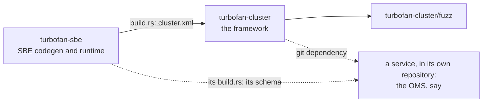
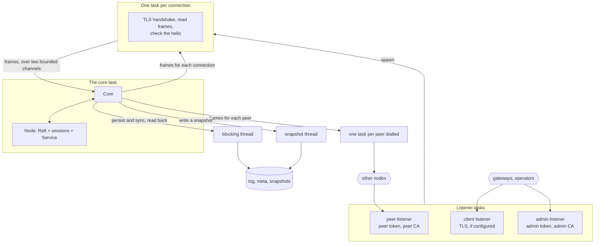
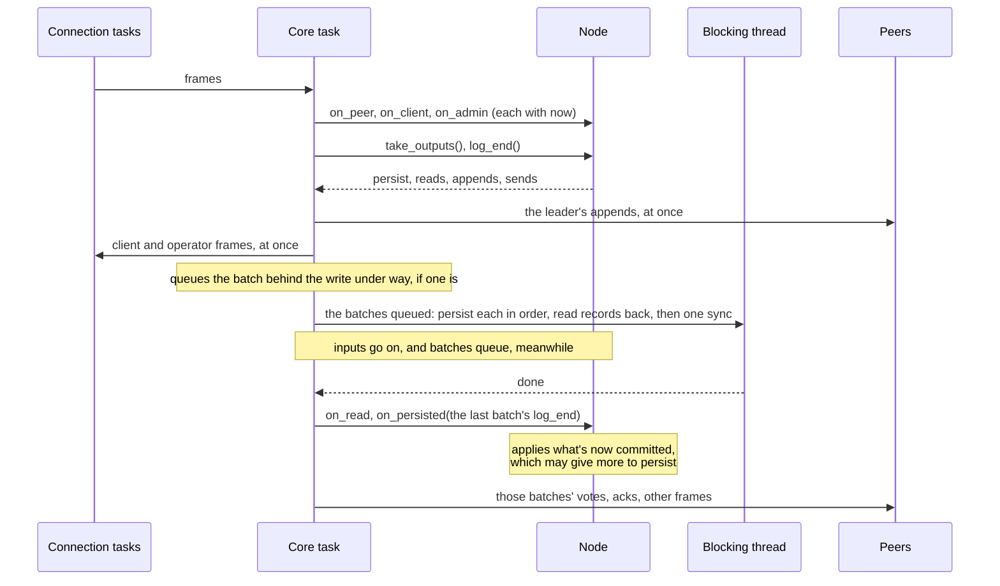
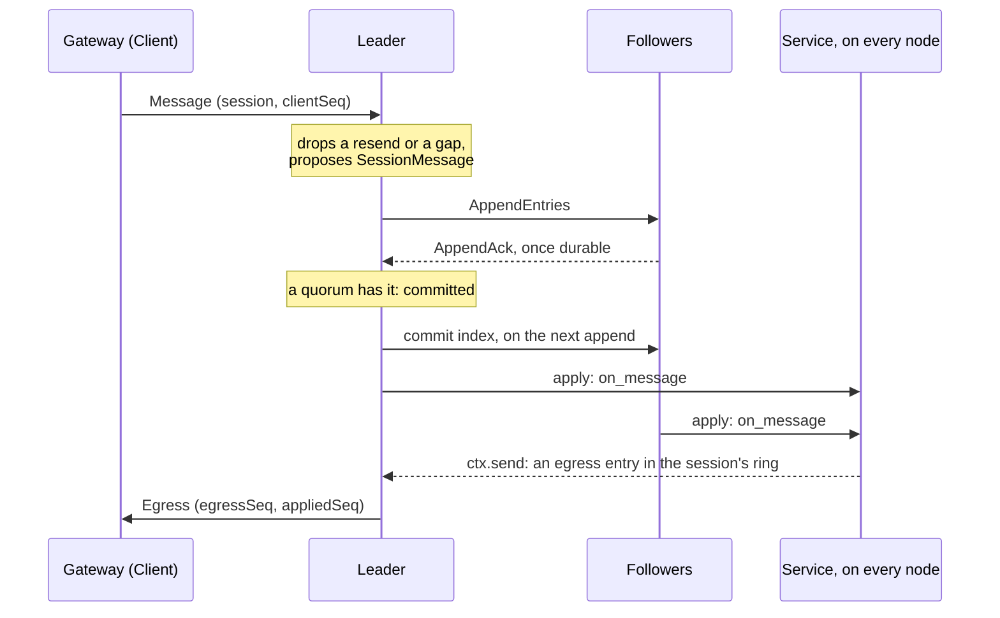

# Architecture

An overview of how Turbofan fits together, for working on it. Each crate's README says how to use
it, [WIRE.md](WIRE.md) how the wire protocol may change,
[ROADMAP.md](ROADMAP.md) what's left, and
[STYLE.md](../../../docs/STYLE.md) the house style.

## The crates

An arrow points from a crate to one that depends on it. `turbofan-sbe` generates codecs from SBE
schemas in a `build.rs`, and is also the runtime those codecs call. `turbofan-cluster` is the
reusable core: Raft, client sessions, the disk and the network. It knows nothing of what a
service does: a service's messages are opaque bytes to it. Services live in repositories of their
own, depending on both crates by git: the [OMS](https://github.com/jrogers/oms), an order book,
is one. Here, `examples/counter.rs` is a service small enough to read whole. The fuzz crate sits
outside the workspace, with a lock file of its own.

## Layers

The cluster is built in layers, each tested on its own:

| Layer | Where | What it does |
|---|---|---|
| Wire | `schema/cluster.xml`, `codec.rs` | Every message between nodes, clients and operators, and every log entry, as SBE; frames (a `u32` length, then a message) and log records (length, checksum, term, index, payload). |
| Raft | `raft/`: `election`, `replication`, `membership`, `snapshots`, `entries` | Sans-IO Raft over opaque records: pre-vote elections, replication, commit, membership changes, leadership transfer, snapshots sent to followers. |
| Node | `node/`: `sessions`, `apply`, `state`, `admin`, `service` | Raft plus what the log means: client sessions, de-duplication, egress rings, timers, the service's own proposals, admin requests, all applied to a `Service`. |
| Storage | `log.rs`, `meta.rs`, `snapshot.rs` | The log in segment files, the term and vote in two alternating slots, snapshot files written whole or not at all. |
| Driver | `driver.rs` | Runs a `Node` on tokio: listeners for peers, clients and operators, the disk on blocking threads, the batch loop. |
| Client | `client.rs`, `remote.rs` | A sans-IO gateway session (`Client`) that finds the leader and keeps a session across failovers, run over TCP by `ClusterClient`; operators' requests. |
| Command line | `cli.rs` | `serve` and the operator commands, so a service's binary is one call to `run`. |
| Metrics | `metrics.rs` | What a node counts, published by the driver through the `metrics` facade. |

`raft/` replicates records and knows nothing of sessions or services; `node/` layers those on
top. Only the driver, `remote.rs` and `cli.rs` do IO.

## The core is sans-IO

`Raft`, `Node` and `Client` do no IO and read no clock. Every input comes with `now`, in
nanoseconds; outputs are taken back as plain data. For a `Node`:

- **In:** `on_peer`, `on_client` and `on_admin` (each decoded frame, with where it came from),
  `on_disconnect`, `on_tick` (when `next_deadline` falls due), `on_persisted` (the batch is
  durable), `on_read` (log records read back from disk), `on_snapshot_read`,
  `on_snapshot_saved`, and `restore` (from a snapshot file).
- **Out:** `take_outputs`: what to persist, in order; log records and snapshot chunks to read
  back; the leader's appends and frames for clients, to send at once; frames for peers, to send
  once the batch, and every one before it, is durable; a snapshot to write; the peers to dial;
  commit latencies.
- **And** `raft().log_end()`, noted as outputs are taken, to give `on_persisted`.

So every decision is in `raft/` and `node/`, tested without sockets, and simulated
(`tests/sim.rs`) by a harness that drives the same `Node` over a model network and real files.
How a driver carries out the outputs, what goes at once and what waits for which write, is in
`pipeline.rs`, which the driver and the simulation both run. The driver decides only when to call
them, and does the IO.

The service sees only what the log gives it. Time is the leader's clock, recorded in each entry
(`Ctx::now`); a service mustn't use another clock, randomness, IO, or a hash map's iteration
order, since every node runs it over the same log and must reach the same state.

## At run time

- **One task owns the node** and does everything in order. Connection tasks only frame bytes and
  check handshakes, and pass whole frames to it over bounded channels (`MAX_QUEUED_INPUTS`), one
  for clients and one for the rest. It takes up to `MAX_BATCH_INPUTS` at a time.
- **A backlogged leader holds clients back.** Once its proposals not yet committed come to
  `max_uncommitted_bytes`, the node takes nothing more from clients until they commit: their
  channel fills, their connection tasks wait, and TCP pushes back on them. Peers' acks still
  come in, so the backlog clears.
- **Peer connections go one way.** Each node dials every other to send to it, and reads what
  arrives on the connections dialled to it. A frame a slow or absent peer can't take is dropped:
  Raft sends it again.
- **The disk never blocks the node.** Batches are written and synced on a blocking thread, one
  write at a time. Meanwhile the node goes on with its inputs (acks commit, clients are answered),
  and the batches it gives are queued, to be written next, together, with one sync: that's the
  group commit. Only a restore from a snapshot waits for the disk.
- **Snapshots are taken off the apply path.** `Service::snapshot` returns a frozen copy, which a
  thread writes out while the node goes on applying. The log is compacted once it's durable.

## One batch

Each time the core task wakes (input arrived, a deadline passed, or a write is done), it takes one
batch:

**The driver's one rule:** persist in order and make it durable, then call `on_persisted`, and
only then send to peers what that batch, and every one before it, gave. A vote or an ack never goes
out ahead of the state it promises. A leader's appends are the exception: they go out at once, so
followers write the records while the leader does. The leader counts itself towards a commit only
once its own copy is durable: `on_persisted` takes the log's end as it was when the batch was
taken, and counts it only if that entry is still there, not replaced by a new leader's since.
With the log's `Fsync::Never`, the default, durable means written, to the OS: it survives the
process, not the machine.

Clients are answered at once, not after the batch: they're only told what's committed, which a
quorum has durable, whatever this node's disk has yet.

A failed write or sync stops the node: its durable state is unknown. Restarted, it recovers from
what's on disk.

## A message's path

Messages apply exactly once and in order, and responses arrive exactly once and in order, while a
session lasts:

- **Sessions are replicated.** Opening one is a `SessionOpen` entry, and its ID is that entry's
  index. The leader asks `Service::authenticate` before logging it, and logs the principal it
  returns, never the credentials.
- **De-duplication is replicated.** A session's last applied `clientSeq` is part of the state, so
  every node drops the same resends. The leader proposes each message once a term, in order, and at
  most `MAX_UNACKED` ahead of what's applied; a client keeps to the same window.
- **Responses are kept.** Each session's last `egress_ring_entries` responses are replicated, with
  their `egressSeq`. A client that reconnects after a failover reattaches with the last it saw, and
  the new leader replays the rest. It then resends what isn't applied yet.
- **Only the leader talks to clients.** A follower redirects a client to the leader. A new leader
  takes clients once its `NewTerm` entry has applied, and so everything before it too.
- **Liveness is the leader's.** Sessions not heard from within the session timeout are closed by
  a `SessionClose` entry. Timers fire as `TimerFired` entries, and a service's own messages
  (`Ctx::propose`) as `ServiceProposal` entries, each applied once, even when the leaders either
  side of a failover both log it.

## Durability

| What | Where | How it survives a crash |
|---|---|---|
| The log | `log.rs` | Records in segment files named by their first index, not synced by default (`Fsync::Never`): a crashed process loses nothing, and the other nodes' copies cover a machine lost; a majority losing power together may lose committed entries. `Fsync::EachBatch` (`serve --fsync`) syncs once a batch. On open, a torn last record is truncated; damage anywhere else stops the node, to be replaced. |
| Term and vote | `meta.rs` | Two fixed slots, written alternately and synced, each with a generation and a checksum: a torn write leaves the other whole. |
| Snapshots | `snapshot.rs` | Written to a temporary file, synced, renamed, then the directory synced: the old one or the new one, whole. A checksum covers the bytes and the members. |

The node keeps every entry's term in memory, and the records of the entries not yet applied and of
a window of the latest applied (`log_window_bytes`). A follower further behind gets records read
back from disk, or the latest snapshot, in chunks.

**Doubt.** Bit rot in the last record looks like a torn write, so the record dropped may have been
acknowledged. The node then doubts its log, durably (a `doubt` file), and its votes say so. An
election needs one vote more than a majority for each voter in doubt, so the voters still include
one that holds any committed entry. The doubt ends once the node holds an entry or snapshot of a
later term, or the whole log of the leader it follows.

## Changing a running cluster

- **Members** change one at a time, through the log: a `Members` entry takes effect as it's
  appended. A new member catches up without a vote first. At most `MAX_MEMBERS` (7). A
  learner is a member that takes the log but never votes or stands, so commits, check-quorum
  and the snapshot quorum count voters only (`add-member --learner`, or `serve --learners`).
- **The epoch** names the cluster: its first leader logs an `Epoch` entry, and every hello
  carries it as the node has applied it (0 for none yet). Peers that know different epochs don't
  talk, checked on every frame, so a connection outlives no change of epoch. **Promotion**
  (`promote`, to a learner whose leader is silent) makes the learner the one member of a new
  cluster, of a new epoch, from its log as it is, for a standby to take over a lost cluster.
- **Leadership transfer**: the leader sends the target no more of its log than it had when the
  transfer began, then `TimeoutNow` once the target has it all, so a rolling restart costs a
  quick election.
- **Versions.** Nodes advertise the highest protocol and service versions they support on every
  ack. An operator's `activate` logs an `Activated` entry once every member supports the versions,
  so behaviour changes at the same index on every node. [WIRE.md](WIRE.md)
  says which changes need this.
- **Shutdown** snapshots every member at the same index and stops them, so a restart loads the
  snapshot rather than replaying the log.

## Where things are decided

| To change | Look at |
|---|---|
| Elections, replication, commit, membership | `raft/` (`election.rs`, `replication.rs`, `membership.rs`), with a unit test in `raft/tests.rs` and a run of the simulator. |
| What an entry does, sessions, the service's API | `node/`: `Service` and `Ctx` in `service.rs`, `apply_entry` in `apply.rs`, sessions in `sessions.rs`. |
| A message on the wire or in the log | `schema/cluster.xml`, only as WIRE.md allows; never the generated code. |
| When the driver persists, reads and sends | `Core::run` and `Core::flush` in `driver.rs`. |
| Formats on disk | `codec.rs` (records), `log.rs`, `meta.rs`, `snapshot.rs`. |
| How a gateway finds the leader and resends | `client.rs`, and `ClusterClient` in `remote.rs`. |
| Settings | `raft::Config`, `node::Config` and `driver::Config`, and their defaults in `cli.rs`. |
| Limits | The `MAX_` constants in `codec.rs`, `raft/mod.rs`, `node/mod.rs`, `client.rs`, `remote.rs`, `log.rs` and `driver.rs`. |
| The generated codecs | `turbofan-sbe`'s `codegen/`; its checked-in test codecs are rewritten with `SBE_REGENERATE=1`. |

## How it's tested

| Test | Where | Finds |
|---|---|---|
| Unit tests | each module | Each rule, against the sans-IO `Raft`, `Node` and `Client`. |
| Deterministic simulation | `tests/sim.rs` | Lost, repeated or reordered messages, responses and timers under delays, drops, partitions, crashes mid-batch, slow disks, rot, membership changes, transfers and rolling upgrades; replayable from `SIM_SEED`. |
| A real cluster | `tests/cluster.rs` | Mistakes in the driver: three nodes over TCP and files, killed and restarted, joining and leaving, with tokens; and over TLS, refusing who has no certificate or the wrong one. |
| Fuzzing | `fuzz/` (`scripts/fuzz.sh`) | Panics on what the network sends: frames and records (`decode`), and any sequence of client and admin steps against a node (`client`). |
| Codecs | `turbofan-sbe/tests/sbe.rs` | Generated code that differs from what's checked in, or from real-logic's SBE codecs' bytes. |
| Benchmark | `benches/cluster.rs` | Throughput, and latency to p99.9, of three nodes over TCP and synced files; CI puts each run's in its summary. |

`scripts/check.sh` runs fmt, clippy (the fuzz crate's too), the tests (16 simulation seeds),
rustdoc and `cargo deny`. CI runs the same on every push, less the fuzz build and the
simulation, and runs the benchmark too. `SIM_SEEDS=1000 cargo test -p turbofan-cluster
--release --test sim` runs more seeds.
